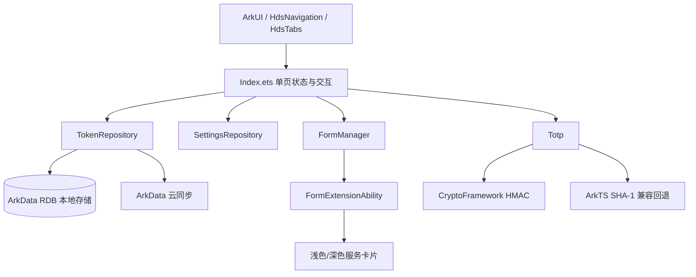

<div align="center">
  
  <h1>OpenAuthenticator</h1>
  <p><strong>开源验证器</strong>，面向 HarmonyOS 的原生二次验证令牌管理应用</p>
  <p>
    
    
    
    
  </p>
</div>

## 项目简介

OpenAuthenticator（开源验证器）是一款使用 ArkTS、ArkUI、Stage 模型与 HarmonyOS 原生系统能力开发的 2FA 令牌管理应用。应用支持 TOTP、HOTP、Steam 令牌，兼容 Google Authenticator 迁移二维码，提供本地存储、华为云空间同步、备份导出、服务卡片、多语言、深浅色模式和多端响应式布局。

密钥属于高敏感数据。应用默认将令牌保存在本机应用私有数据中；导出的 JSON 文件或二维码图片请由用户自行妥善保管。

## 应用介绍图

### 手机端

<table>
  <tr>
    <td></td>
    <td></td>
    <td></td>
    <td></td>
    <td></td>
  </tr>
</table>

### 电脑端

<table>
  <tr>
    <td></td>
    <td></td>
    <td></td>
    <td></td>
    <td></td>
  </tr>
</table>

## 界面预览

<table>
  <tr>
    <td align="center"><br>令牌首页</td>
    <td align="center"><br>新增令牌</td>
    <td align="center"><br>我的页面</td>
    <td align="center"><br>设置页面</td>
  </tr>
</table>

## 亮点功能

- **标准令牌算法**：支持 TOTP、HOTP、Steam，支持 SHA1、SHA224、SHA256、SHA384、SHA512 与 SHA3。
- **灵活令牌配置**：支持 4/5/6/8 位令牌长度、30/60 秒刷新时间，类型切换时自动约束算法、长度与刷新规则。
- **多种录入方式**：支持手动录入、系统扫码、文件导入、`otpauth://` URI，以及 Google Authenticator `otpauth-migration://` 批量迁移。
- **清晰令牌卡片**：展示当前令牌、下一组令牌、圆形倒计时；支持搜索、置顶、编辑、删除与左滑操作。
- **本地优先备份**：支持选择令牌导出为 JSON 或二维码图片，也支持从主流备份格式导入并进行基础密钥校验。
- **华为云空间同步**：基于 ArkData 同应用端云数据同步，支持自动同步、手动推送、手动获取与同步状态展示。
- **桌面服务卡片**：提供 1x2、2x2、2x4、4x4 四种尺寸，每种尺寸包含浅色和深色版本。
- **多端自适应**：令牌列表、我的页、设置页和新增页支持手机、平板、折叠屏与 2in1 设备响应式多列布局。
- **原生系统体验**：使用 ArkUI 原生组件、HdsNavigation、HdsTabs、标准 Sheet、系统文件选择器、扫码能力与服务卡片管理器。
- **个性化与多语言**：支持跟随系统/深色/浅色模式、六套主题色、简体中文、繁体中文、English(US)、English(UK)。
- **隐私与安全**：支持应用锁定，预留智感握姿、防窥保护入口；不支持的系统能力保持上架版稳定提示。
- **首次引导**：四页功能介绍，帮助新用户快速理解录入迁移、服务卡片、备份与隐私能力。

## 服务卡片

| 规格 | 显示数量 | 浅色 | 深色 |
| --- | ---: | :---: | :---: |
| 1x2 | 1 个令牌 | 支持 | 支持 |
| 2x2 | 2 个令牌 | 支持 | 支持 |
| 2x4 | 4 个令牌 | 支持 | 支持 |
| 4x4 | 8 个令牌 | 支持 | 支持 |

在“设置 > 服务卡片”中选择需要显示的令牌与顺序，再点击“选择服务卡片”拉起系统服务卡片管理器添加到桌面。令牌数据更新后，已注册卡片会同步刷新。

## 技术架构



主要目录：

```text
entry/src/main/ets/
├── pages/Index.ets                       # 主界面、设置、导入导出、响应式布局
├── model/TokenRecord.ets                 # 令牌数据模型与兼容清洗
├── data/TokenRepository.ets              # ArkData RDB、本地存储、云同步
├── data/SettingsRepository.ets           # 用户设置、语言、主题、引导状态
├── utils/Totp.ets                        # TOTP/HOTP/Steam 生成逻辑
├── utils/GoogleAuthenticatorMigration.ets
├── utils/LocaleText.ets                  # 运行时多语言文案
├── form/FormAbility.ets                  # 服务卡片扩展能力
├── form/FormManager.ets                  # 卡片选择、快照与刷新
└── form/pages/                           # 四种尺寸、浅色/深色卡片 UI
```

## 构建环境

- DevEco Studio
- HarmonyOS SDK `6.1.1(24)` release API
- ArkTS Stage 模型
- Bundle：`com.example.tool_2fa`
- Version：`1.0`
- 设备类型：phone、tablet、2in1

DevEco Studio 中可直接构建，也可使用项目约定命令：

```bash
build_project
build_project --module entry
build_project --build_mode release
```

## 云同步配置

华为云空间同步依赖 AppGallery Connect 与 ArkData 同应用端云数据同步配置。真机调试前请确认：

1. Bundle、签名证书、指纹和 AGC 项目一致。
2. 已启用云数据库/云同步能力，并配置与本地 `tokens` 表匹配的云端对象。
3. 测试华为账号已加入测试范围，并在系统云空间中开启应用同步。
4. 应用包含 `ohos.permission.DISTRIBUTED_DATASYNC` 权限。
5. 重新登录设备华为账号或重新安装应用后，再验证手动推送/手动获取。

云侧容器名为 `tool_2fa_tokens`，数据类型名为 `tokens`。字段建议如下，其中 `id` 勾选主键，`secret` 使用 `Encrypted String`：

| 字段 | 云侧类型 |
| --- | --- |
| id | String |
| name | String |
| remark | String |
| type | String |
| algorithm | String |
| secret | Encrypted String |
| logoUri | String |
| logoLightUri | String |
| logoDarkUri | String |
| logoSource | String |
| digits | Integer |
| period | Integer |
| counter | Integer |
| createdAt | Integer |
| sortIndex | Integer |

## 数据兼容

- 标准 URI：`otpauth://totp/...`、`otpauth://hotp/...`
- Google Authenticator：`otpauth-migration://offline?data=...`
- 文件导入：JSON、TXT、CSV、TSV、`.otpauth`、`.mafile`、`.2fas`
- 本应用备份：JSON 文件与逐令牌二维码
- 密钥校验：导入前会校验类型、算法、令牌长度、刷新时间和 Base32/Steam 密钥格式

## 上架说明

- 本仓库当前面向 HarmonyOS release SDK `6.1.1(24)`，避免依赖 beta-only API。
- DevEco Previewer 不一定渲染系统级模糊、沉浸材质、扫码、账号、云同步、媒体库和服务卡片能力，请以真机或模拟器验证为准。
- 智感握姿、防窥保护等能力受设备系统能力限制，上架版保持可见入口与稳定提示。
- 真实密钥、二维码、账号信息和云同步日志不应提交到仓库或 issue。

## 辅助材料

- `cloud-hosting/public/user-agreement.html`：用户协议云托管页面。
- `marketing_assets/app_store_screenshots/`：应用商店手机端与电脑端介绍图。
- `marketing_assets/app_store_screenshots_svg/`：可继续编辑的 SVG 介绍图。

## 贡献

欢迎通过 GitCode Issue 提交问题与建议。提交问题时请移除真实账号、密钥、二维码、令牌值和敏感日志。
