<div align="center">
  
  <h1>OpenAuthenticator</h1>
  <p><strong>开源验证器</strong>，面向 HarmonyOS 的原生二次验证令牌管理应用</p>
  <p>
    
    
    
    
    
  </p>
</div>

## 项目简介

OpenAuthenticator（开源验证器）是一款使用 ArkTS、ArkUI、Stage 模型与 HarmonyOS 原生系统能力开发的 2FA 令牌管理应用。应用支持 TOTP、HOTP、完整 Steam Guard、Google Authenticator 迁移二维码，提供本地存储、华为云空间同步、备份导出、服务卡片、多语言、主题背景和多端响应式布局。

密钥属于高敏感数据。应用默认将令牌保存在本机应用私有数据中；导出的 JSON 文件或二维码图片请由用户自行妥善保管。

## 下载与侧载

- 当前版本：`1.4.4`（`versionCode 1000047`）
- 系统要求：HarmonyOS `6.1.0(23)` 或更高版本
- 支持设备：手机、手表、平板与 2in1
- 安装包：请从 [GitCode Releases](https://gitcode.com/mroble/Authenticator/releases) 获取 `OpenAuthenticator-v1.4.4.hap`
- 版本说明：[CHANGELOG.md](CHANGELOG.md)

安装前请在设备上开启开发者模式和 USB 调试，在电脑安装并连接 HDC 后执行：

```bash
hdc list targets
hdc app install -r OpenAuthenticator-v1.4.4.hap
```

看到 `successfully` 后即可从桌面启动“开源验证器”。安装包使用 HarmonyOS release / AppGallery 分发证书签名；系统是否允许直接从文件管理器打开 HAP 安装取决于设备版本和安全策略，遇到限制时请使用 HDC。升级安装会保留应用数据，但仍建议先在应用内导出备份。请只从本仓库的 [Releases](https://gitcode.com/mroble/Authenticator/releases) 页面下载安装包，并核对 SHA-256。

## 应用介绍图

### 手机端

<table>
  <tr>
    <td>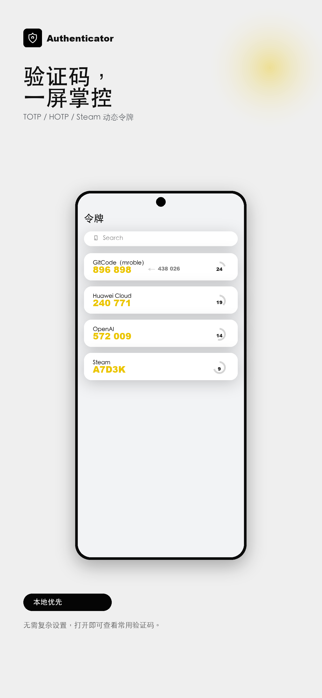</td>
    <td>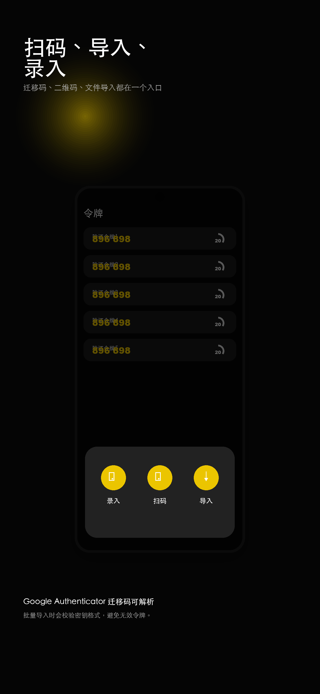</td>
    <td>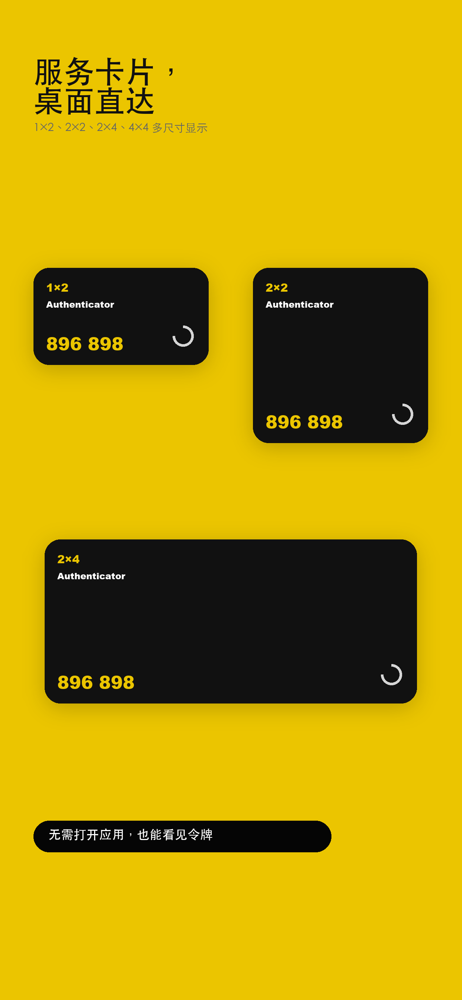</td>
    <td>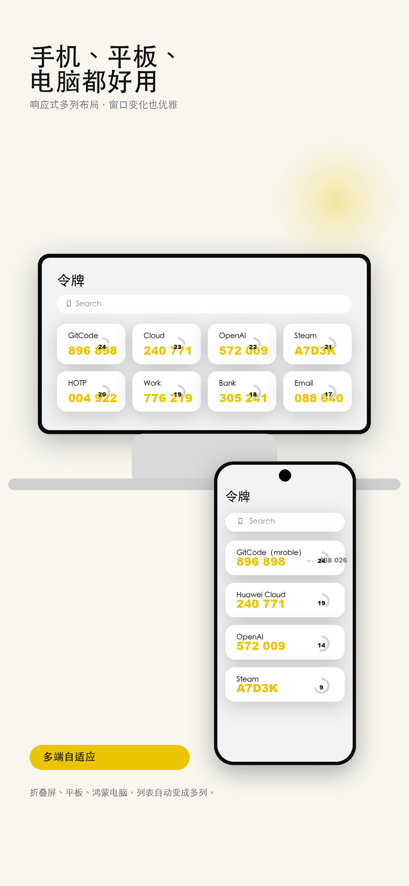</td>
    <td>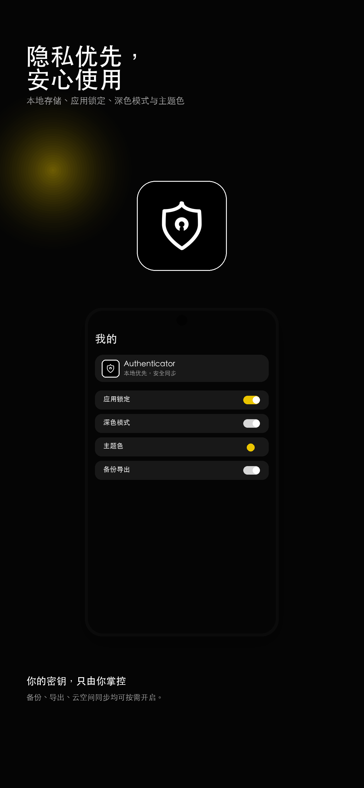</td>
  </tr>
</table>

### 电脑端

<table>
  <tr>
    <td>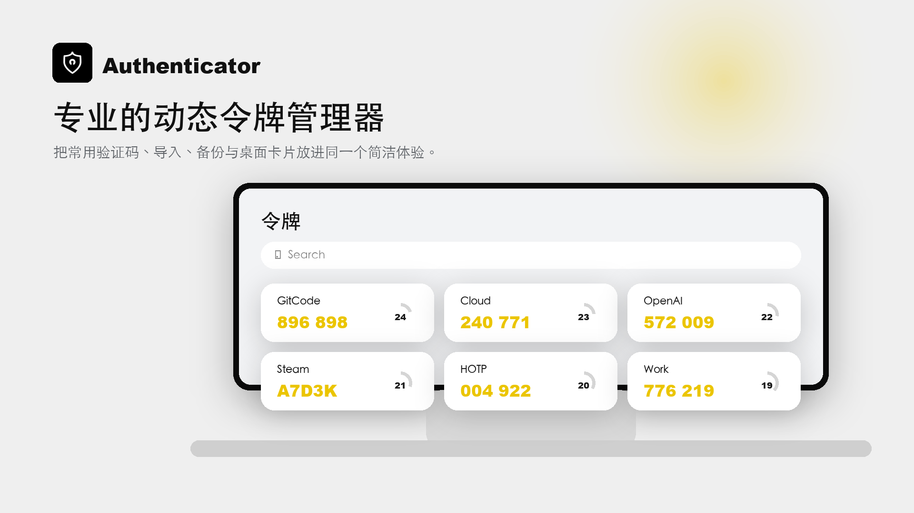</td>
    <td>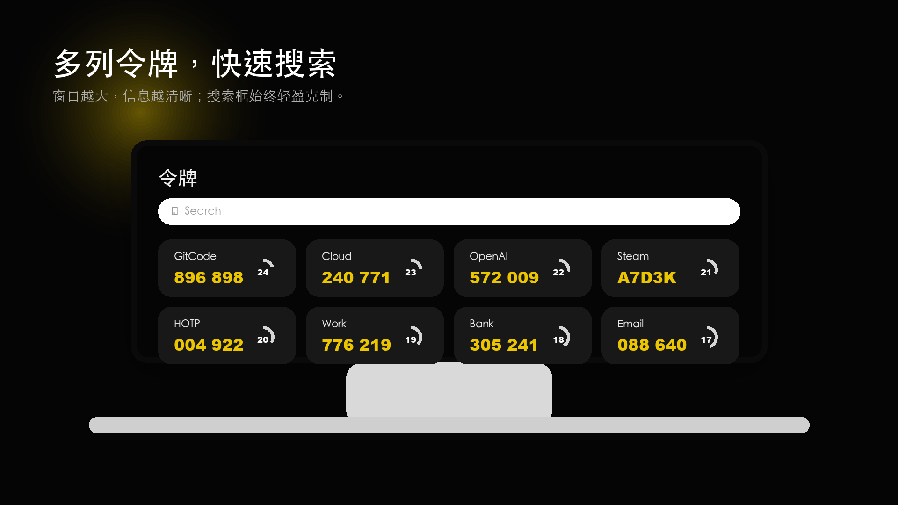</td>
    <td>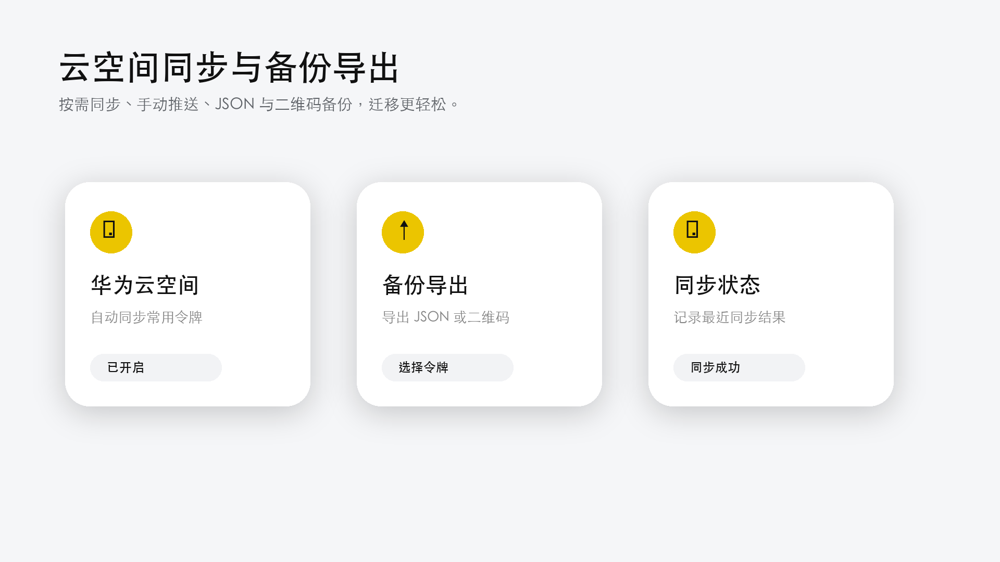</td>
    <td>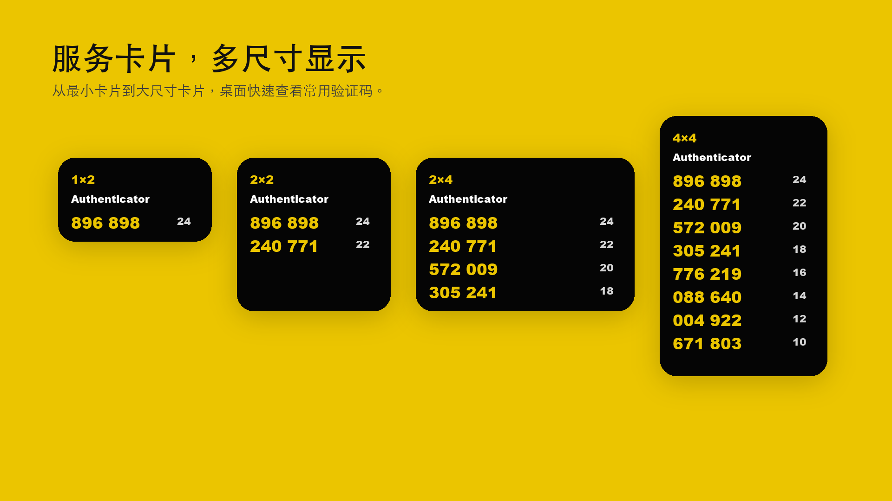</td>
    <td>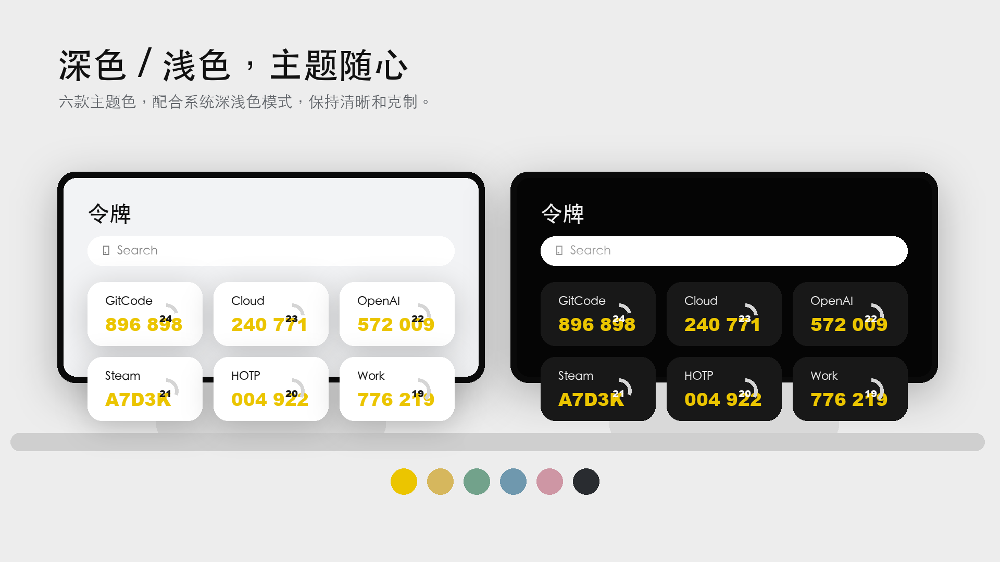</td>
  </tr>
</table>

## 界面预览

<table>
  <tr>
    <td align="center">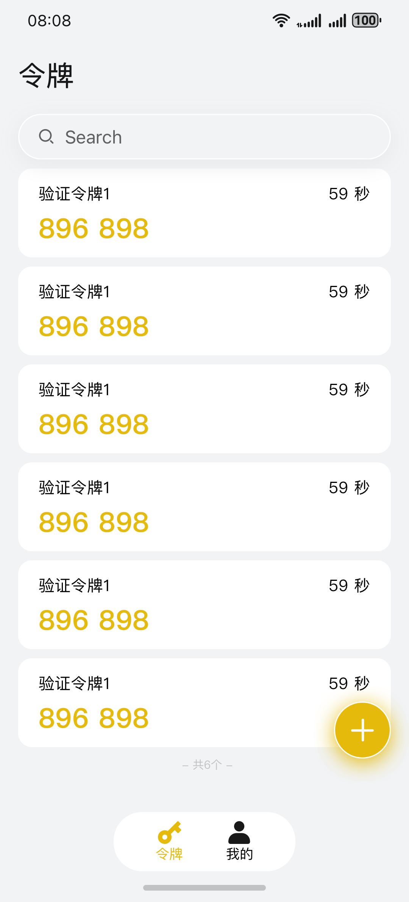<br>令牌首页</td>
    <td align="center">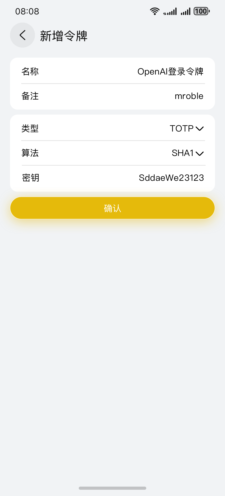<br>新增令牌</td>
    <td align="center">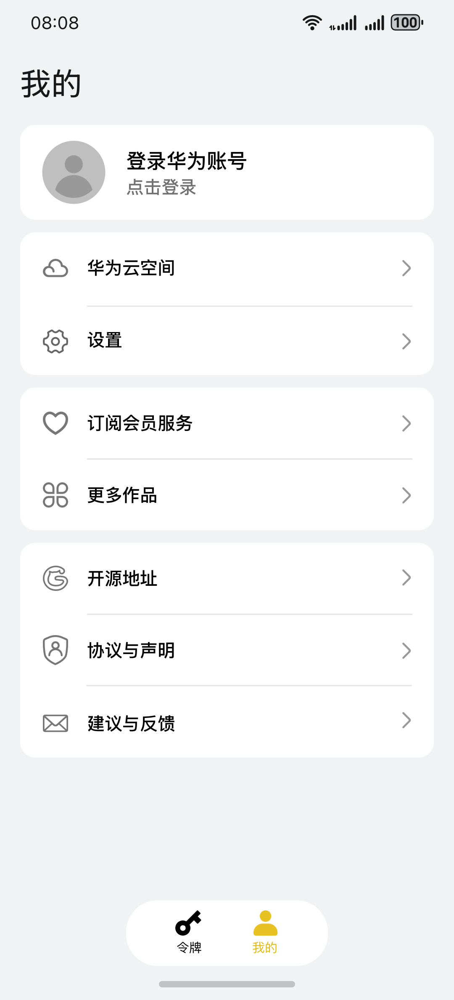<br>我的页面</td>
    <td align="center">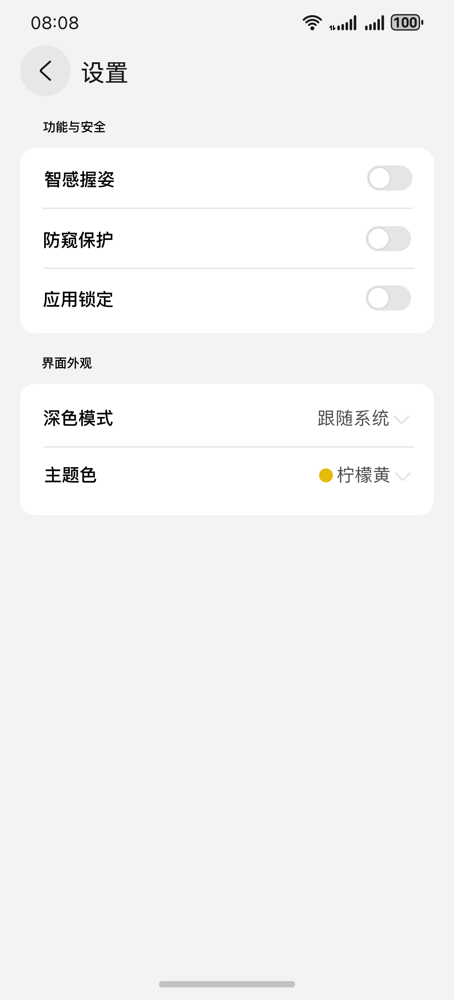<br>设置页面</td>
  </tr>
</table>

## 亮点功能

- **标准令牌算法**：支持 TOTP、HOTP、Steam，支持 SHA1、SHA224、SHA256、SHA384、SHA512 与 SHA3。
- **灵活令牌配置**：支持 4/5/6/8 位令牌长度、30/60 秒刷新时间，类型切换时自动约束算法、长度与刷新规则。
- **多种录入方式**：支持手动录入、系统扫码、文件导入、`otpauth://` URI，以及 Google Authenticator `otpauth-migration://` 批量迁移。
- **清晰令牌卡片**：展示当前令牌、下一组令牌、圆形倒计时；支持搜索、置顶、编辑、删除与左滑操作。
- **本地优先备份**：支持选择令牌导出为 JSON 或二维码图片，也支持从主流备份格式导入并进行基础密钥校验。
- **华为云空间同步**：基于 ArkData 同应用端云数据同步，支持自动同步、手动推送、手动获取与同步状态展示。
- **完整 Steam Guard**：支持未加密/加密 maFile 导入、账号登录生成验证器、恢复码保存、扫码登录、交易确认和 maFile 导出。
- **Steam 凭证云同步**：使用独立加密云表同步结构化 Steam 登录凭证与交易确认信息，不改变通用令牌同步逻辑。
- **手机与手表同步**：保留 Wear Engine 推送，并支持通过同一 Wi-Fi 扫描手表配对码同步令牌，无需配置 Wear Engine Client ID。
- **桌面服务卡片**：提供 1x2、2x2、2x4、4x4 四种尺寸，每种尺寸包含浅色和深色版本。
- **多端自适应**：令牌列表、我的页、设置页和新增页支持手机、平板、折叠屏与 2in1 设备响应式多列布局。
- **原生系统体验**：使用 ArkUI 原生组件、HdsNavigation、HdsTabs、标准 Sheet、系统文件选择器、扫码能力与服务卡片管理器。
- **个性化与多语言**：支持跟随系统/深色/浅色模式、六套主题色、简体中文、繁体中文、English(US)、English(UK)。
- **主题背景**：支持七张预设图、图库自选、模糊程度调节及全局二级页面背景。
- **隐私与安全**：支持应用锁定，预留智感握姿、防窥保护入口；不支持的系统能力保持上架版稳定提示。
- **首次引导**：四页功能介绍，帮助新用户快速理解录入迁移、服务卡片、备份与隐私能力。

## 服务卡片

| 规格 | 显示数量 | 浅色 | 深色 |
| --- | ---: | :---: | :---: |
| 1x2 | 1 个令牌 | 支持 | 支持 |
| 2x2 | 2 个令牌 | 支持 | 支持 |
| 2x4 | 4 个令牌 | 支持 | 支持 |
| 4x4 | 8 个令牌 | 支持 | 支持 |

在“设置 > 服务卡片”中选择需要显示的令牌与顺序，再点击“选择服务卡片”拉起系统服务卡片管理器添加到桌面。令牌数据更新后，已注册卡片会同步刷新。

## 手机与手表同步

局域网扫码同步不依赖 Wear Engine、AppGallery Connect Client ID 或两端签名一致，但手机与手表都需要安装包含此功能的 OpenAuthenticator。

1. 在手表端打开 OpenAuthenticator，在令牌页向左滑进入“功能”页，点击“手机扫码同步”自动生成配对二维码。
2. 在手机端进入“我的 > 手表端数据同步”，选择令牌后点击“扫码同步到手表”。
3. 扫描手表上的二维码，等待两端显示同步成功。

手表启动时默认显示令牌列表；功能页向右滑返回令牌，手机同步页向右滑会关闭当前配对会话并返回功能页。在令牌页向右滑会退出应用。令牌较多时可旋转表冠滚动浏览。

两端必须处于可互相访问的同一 Wi-Fi；开启 AP 隔离的访客网络无法使用。配对会话两分钟后失效且成功后立即关闭。二维码包含本次会话的一次性 256 位密钥，请勿分享截图。

同步使用 mDNS 发现手表，通过 TCP 传输 AES-256-GCM 加密且带完整性校验的数据。手表会以手机所选令牌替换当前列表；仅传输生成验证码所需字段，不传输 Steam 登录会话令牌、设备标识、恢复码或交易确认凭证。

## 技术架构

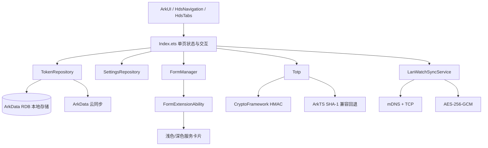

主要目录：

```text
entry/src/main/ets/
├── pages/Index.ets                       # 主界面、设置、导入导出、响应式布局
├── model/TokenRecord.ets                 # 令牌数据模型与兼容清洗
├── data/TokenRepository.ets              # ArkData RDB、本地存储、云同步
├── data/SteamGuardCloudRepository.ets    # Steam Guard 独立加密云表同步
├── data/SteamGuardCloudSchema.ets        # Steam Guard 云表结构
├── data/SteamEnrollmentService.ets       # Steam 登录及验证器激活
├── data/SteamService.ets                 # Steam 扫码登录与交易确认
├── data/LanWatchSyncService.ets          # 局域网扫码配对、加密传输与手表接收
├── model/SteamGuardData.ets              # 完整 Steam Guard 数据模型
├── data/SettingsRepository.ets           # 用户设置、语言、主题、引导状态
├── utils/Totp.ets                        # TOTP/HOTP/Steam 生成逻辑
├── utils/GoogleAuthenticatorMigration.ets
├── utils/LocaleText.ets                  # 运行时多语言文案
├── form/FormAbility.ets                  # 服务卡片扩展能力
├── form/FormManager.ets                  # 卡片选择、快照与刷新
└── form/pages/                           # 四种尺寸、浅色/深色卡片 UI
```

## 构建环境

- DevEco Studio
- HarmonyOS SDK `6.1.0(23)` release API
- ArkTS Stage 模型
- Bundle：`com.example.tool_2fa`
- Version：`1.4.4`（`versionCode 1000047`）
- 设备类型：phone、tablet、2in1

DevEco Studio 中可直接构建，也可使用项目约定命令：

```bash
build_project
build_project --module entry
build_project --build_mode release
```

## 云同步配置

华为云空间同步依赖 AppGallery Connect 与 ArkData 同应用端云数据同步配置。真机调试前请确认：

1. Bundle、签名证书、指纹和 AGC 项目一致。
2. 已启用云数据库/云同步能力，并配置与本地 `tokens`、`steamGuardData` 表匹配的云端对象。
3. 测试华为账号已加入测试范围，并在系统云空间中开启应用同步。
4. 应用包含 `ohos.permission.DISTRIBUTED_DATASYNC` 权限。
5. 重新登录设备华为账号或重新安装应用后，再验证手动推送/手动获取。

云侧容器名为 `tool_2fa_tokens`。通用令牌和完整 Steam Guard 数据使用两个相互独立的数据类型：

- `tokens`：保持现有通用令牌同步逻辑，Steam 令牌也会通过 `secret` 同步通用验证码密钥。
- `steamGuardData`：同步结构化的 Steam 登录凭证、交易确认信息和恢复字段，用于在新设备恢复扫码登录、交易确认并重新生成 maFile。

端侧使用 `local_tokens` 保存完整令牌，使用与云端结构一致的镜像表执行 `NATIVE_FIRST` 推送和 `CLOUD_FIRST` 获取。两个数据类型分别同步、分别统计状态，互不覆盖。原始 maFile、SDA `manifest.json` 和 SDA 本地加密信息不会直接上传云端。

### 通用令牌数据类型 `tokens`

其中 `id` 勾选主键，`secret` 使用 `Encrypted String`：

| 字段 | 云侧类型 |
| --- | --- |
| id | String |
| name | String |
| remark | String |
| type | String |
| algorithm | String |
| secret | Encrypted String |
| logoUri | String |
| logoLightUri | String |
| logoDarkUri | String |
| logoSource | String |
| digits | Integer |
| period | Integer |
| counter | Integer |
| createdAt | Integer |
| sortIndex | Integer |

### Steam Guard 数据类型 `steamGuardData`

`id` 勾选主键。所有凭证类字符串均使用 `Encrypted String`；访问令牌和刷新令牌按约 700 字节拆分为最多三段，避免超过单字段长度限制。

| 字段 | 云侧类型 |
| --- | --- |
| id | String |
| dataVersion | Integer |
| accountName | Encrypted String |
| steamId | Encrypted String |
| sharedSecret | Encrypted String |
| identitySecret | Encrypted String |
| deviceId | Encrypted String |
| accessTokenPartCount | Integer |
| accessTokenPart1 | Encrypted String |
| accessTokenPart2 | Encrypted String |
| accessTokenPart3 | Encrypted String |
| refreshTokenPartCount | Integer |
| refreshTokenPart1 | Encrypted String |
| refreshTokenPart2 | Encrypted String |
| refreshTokenPart3 | Encrypted String |
| sessionId | Encrypted String |
| revocationCode | Encrypted String |
| serialNumber | Encrypted String |
| uri | Encrypted String |
| serverTime | Double |
| tokenGid | Encrypted String |
| secret1 | Encrypted String |
| status | Integer |
| fullyEnrolled | Integer |
| updatedAt | Double |

华为云空间的数据类型和字段只能新增，不能修改或删除。字段名称、大小写和类型必须与上表完全一致；生产环境和开发环境需要分别创建。旧版本仅识别 `tokens`，因此新增 `steamGuardData` 不影响既有用户的通用令牌数据。

## 数据兼容

- 标准 URI：`otpauth://totp/...`、`otpauth://hotp/...`
- Google Authenticator：`otpauth-migration://offline?data=...`
- Authing 令牌：JSON 数组格式，兼容 `account/accountId/secret/algorithm/digits/interval/platform`
- 文件导入：JSON、TXT、CSV、TSV、`.otpauth`、`.mafile`、`.2fas`
- 本应用备份：JSON 文件与逐令牌二维码
- 密钥校验：导入前会校验类型、算法、令牌长度、刷新时间和 Base32/Steam 密钥格式

## 上架说明

- 本仓库当前面向 HarmonyOS release SDK `6.1.0(23)`，避免依赖 beta-only API。
- DevEco Previewer 不一定渲染系统级模糊、沉浸材质、扫码、账号、云同步、媒体库和服务卡片能力，请以真机或模拟器验证为准。
- 智感握姿、防窥保护等能力受设备系统能力限制，上架版保持可见入口与稳定提示。
- 真实密钥、二维码、账号信息和云同步日志不应提交到仓库或 issue。

## 辅助材料

- `cloud-hosting/public/user-agreement.html`：用户协议云托管页面，独立链接为 `https://gitcode.com/mroble/Tool_2FA/raw/main/cloud-hosting/public/user-agreement.html`。
- `marketing_assets/app_store_screenshots/`：应用商店手机端与电脑端介绍图。
- `marketing_assets/app_store_screenshots_svg/`：可继续编辑的 SVG 介绍图。

## 贡献

欢迎通过 GitCode Issue 提交问题与建议。提交问题时请移除真实账号、密钥、二维码、令牌值和敏感日志。

## 开源协议

本项目采用 [MIT License](LICENSE) 开源。你可以使用、复制、修改、合并、发布、分发、再许可或销售本软件，但须保留原始版权声明与许可声明。本软件按“原样”提供，不附带任何形式的担保。
