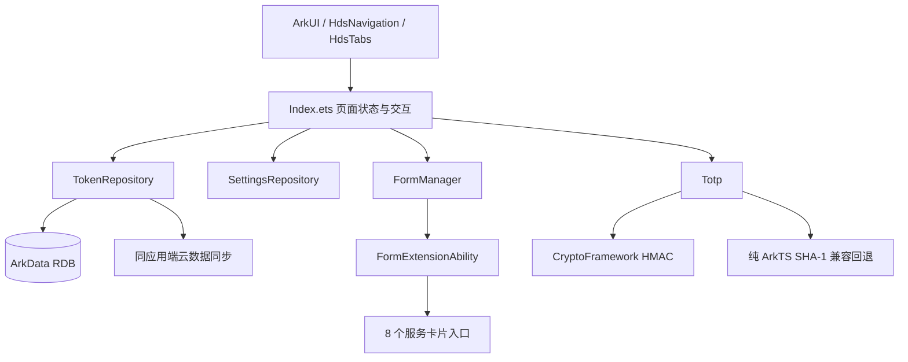

<div align="center">
  
  <h1>Authenticator</h1>
  <p>面向 HarmonyOS 的原生 2FA 令牌管理器</p>
  <p>
    
    
    
  </p>
</div>

## 项目简介

Authenticator 是一款使用 ArkTS、ArkUI 和 HarmonyOS 系统能力构建的本地双因素认证应用。它支持常见动态口令标准、Google Authenticator 迁移二维码、多种备份方式、华为云空间同步、深浅色主题和桌面服务卡片，并针对手机、折叠屏、平板与鸿蒙电脑进行响应式适配。

> 密钥属于高敏感数据。项目默认在应用私有存储中保存令牌；导出 JSON 或二维码后，请由用户自行妥善保管导出文件和画面。

## 界面预览

<table>
  <tr>
    <td align="center"><br>令牌首页</td>
    <td align="center"><br>新增令牌</td>
    <td align="center"><br>我的页面</td>
    <td align="center"><br>设置页面</td>
  </tr>
</table>

## 亮点功能

- **完整令牌标准**：支持 TOTP、HOTP 和 Steam 令牌，支持 4/5/6/8 位口令、30/60 秒刷新周期。
- **多种 HMAC 算法**：支持 SHA1、SHA224、SHA256、SHA384、SHA512 与 SHA3；优先使用系统加密框架。
- **便捷迁移**：支持手动录入、系统扫码、`otpauth://`、Google Authenticator `otpauth-migration://` 批量迁移和文件导入。
- **清晰的令牌卡片**：同时展示当前值、下一组值和环形倒计时；可搜索、置顶、编辑、删除和左滑操作。
- **可靠备份**：支持华为云空间自动同步、手动推送/获取，以及所选令牌导出为 JSON 或二维码。
- **桌面服务卡片**：提供 1x2、2x2、2x4、4x4 四种尺寸，每种均有浅色与深色版本，分别显示 1、2、4、8 个令牌。
- **多端自适应**：列表使用 ArkUI 响应式多列布局，在折叠屏、平板和 2in1 设备上自动利用更宽空间。
- **原生 HarmonyOS 体验**：使用 `HdsNavigation`、`HdsTabs`、系统 Sheet、ActionSheet、文件选择器、扫码与服务卡片管理器。
- **隐私与安全**：支持应用锁定、防窥保护、智感握姿，并提供深浅色模式与多套低饱和主题色。
- **首次引导**：四页可滑动功能介绍，帮助新用户快速了解录入、迁移、服务卡片和安全备份。

## 服务卡片

| 规格 | 显示数量 | 浅色 | 深色 |
| --- | ---: | :---: | :---: |
| 1x2 | 1 个令牌 | 支持 | 支持 |
| 2x2 | 2 个令牌 | 支持 | 支持 |
| 2x4 | 4 个令牌 | 支持 | 支持 |
| 4x4 | 8 个令牌 | 支持 | 支持 |

在应用的“设置 > 服务卡片”中选择需要显示的令牌及顺序，然后通过“选择服务卡片”调用系统卡片管理器添加到桌面。令牌数据更新后，应用会同步刷新已注册的服务卡片。

## 技术架构



主要目录：

```text
entry/src/main/ets/
├── pages/Index.ets                 # 主界面、设置、导入导出和响应式布局
├── model/TokenRecord.ets           # 令牌数据模型与兼容清洗
├── data/TokenRepository.ets        # ArkData 本地存储与云同步
├── data/SettingsRepository.ets     # 用户设置与首次引导状态
├── utils/Totp.ets                  # TOTP/HOTP/Steam 生成逻辑
├── utils/GoogleAuthenticatorMigration.ets
├── form/FormAbility.ets            # 服务卡片扩展能力
├── form/FormManager.ets            # 卡片选择、快照和刷新
└── form/pages/                     # 四种尺寸、浅色/深色卡片 UI
```

## 构建环境

- DevEco Studio，内置 HarmonyOS SDK `6.1.1(24)`
- ArkTS Stage 模型
- 目标设备：phone、tablet、2in1
- Bundle：`com.example.tool_2fa`

在 DevEco Studio 中直接构建，或使用项目约定的命令：

```bash
build_project
build_project --module entry
build_project --build_mode release
```

命令行环境也可以执行 Hvigor：

```bash
DEVECO_SDK_HOME=/Applications/DevEco-Studio.app/Contents/sdk \
JAVA_HOME=/Applications/DevEco-Studio.app/Contents/jbr/Contents/Home \
/Applications/DevEco-Studio.app/Contents/tools/hvigor/bin/hvigorw \
  --no-daemon --mode module -p product=default assembleHap
```

## 云同步配置

华为云空间同步依赖 AppGallery Connect 与 ArkData 同应用端云数据同步配置。调试前请确保：

1. Bundle、应用签名证书和 AGC 项目配置一致。
2. 已为应用启用云数据库/云同步能力，并配置与本地 `tokens` 表匹配的云端对象。
3. 真机已登录加入测试范围的华为账号，并在云空间中启用应用同步。
4. 应用具有 `ohos.permission.DISTRIBUTED_DATASYNC` 权限。

## 数据兼容

- 标准 URI：`otpauth://totp/...`、`otpauth://hotp/...`
- Google Authenticator：`otpauth-migration://offline?data=...`
- 备份：JSON 文件、逐令牌二维码
- 支持 Base32 密钥及常见 URL 编码参数

## 当前说明

- DevEco Previewer 不渲染部分系统级模糊与沉浸材质，请在模拟器或真机验证完整视觉效果。
- 智感握姿、防窥保护、扫码、云同步等能力依赖设备系统能力；不支持的设备会保持基础令牌功能可用。
- 仓库中的测试目录仍以 DevEco 模板为基础，核心算法和迁移解析建议继续补充自动化用例。

## 贡献

欢迎通过 GitCode Issue 提交问题与建议。涉及密钥、二维码或云同步日志时，请先移除真实账号、密钥和令牌值。
